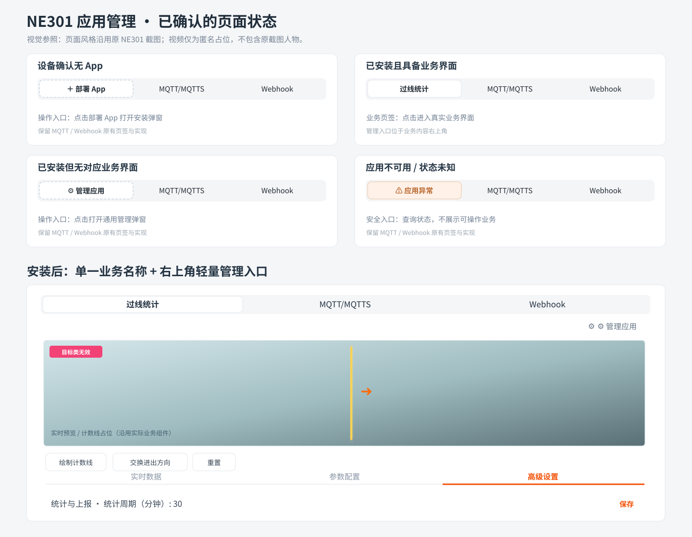
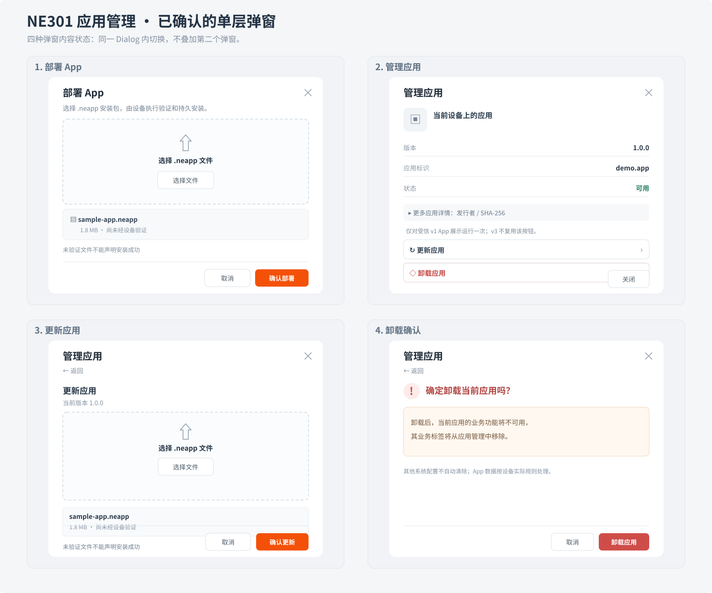
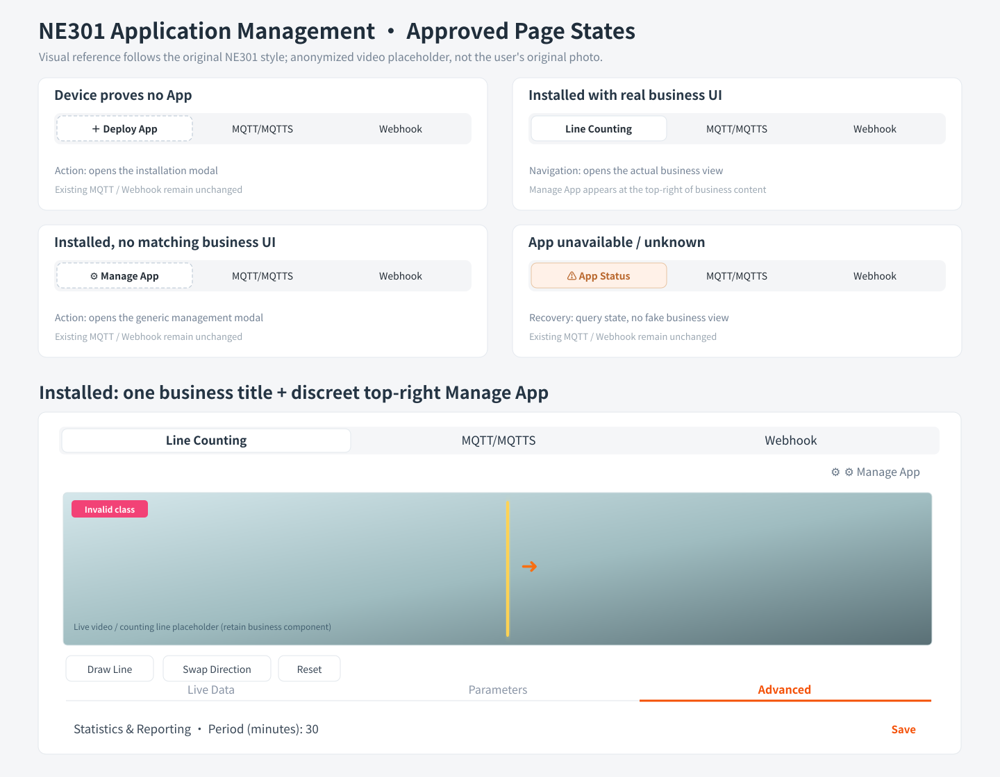
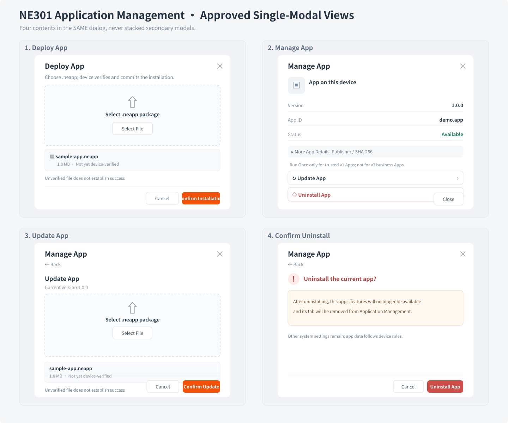

# NE301「应用管理」最终 UI 视觉基准（2026-10-13，用户逐项确认）

> **Authoritative product visual reference for Issue [#39](https://github.com/harryhua-ai/ne301/issues/39) and downstream [#57](https://github.com/harryhua-ai/ne301/issues/57).** B must compare its delivered UI against the **visuals AND semantic text** here. A reviews the output; do not treat mock screenshots as proof that a signed business App already runs.
>
> 这是产品设计验收资产，不是 B 实施代码或后端 API 证据。设计中静态设备身份、版本号、安装文件、MQTT 字段仅供展示；实际内容必须来自真实设备/后端。项目原始截图包含人物影像，**没有**复制到公开仓库；视觉稿只使用匿名视频占位，并继承截图的页面层级、配色、卡片/页签风格。

## A. 视觉稿（中英双语）

| 内容 | 中文 | English |
|---|---|---|
| 四态首位入口 + 安装后实际业务主页面 | [查看 overview-zh.svg](./overview-zh.svg) | [View overview-en.svg](./overview-en.svg) |
| 部署 / 管理 / 更新 / 卸载的同层弹窗效果 | [查看 dialogs-zh.svg](./dialogs-zh.svg) | [View dialogs-en.svg](./dialogs-en.svg) |
| 可独立渲染的高保真视觉原型 | [index.html](./index.html?view=installed&lang=zh) | [index.html](./index.html?view=installed&lang=en) |

### 四态主界面（中文）

### 管理弹窗（中文）

### Visual references (English)

## B. 交互 / 架构与布局约束

1. **唯一入口**：既有 `/application-management` 页面和「应用管理」导航。不得生成新的顶层 `/app-management` 页面或菜单。保留原有 MQTT/MQTTS、Webhook 页签、既有组件与业务行为。
2. **首位区域**：只有四种真实状态：确无 App → 「部署 App / Deploy App」**操作按钮**（轻虚线/描边，与 Tab 不同）；可信已提交且 Web 有**真实**相应业务能力 → 该 App 的**业务 Tab**（如过线统计 / Line Counting）；已安装但无对应 Web 业务 UI → 「管理应用 / Manage App」**操作按钮**；不可用、未知或查询失败 → 「应用异常 / App Status」**状态/安全查询入口**。这四个不是永久并排显示的 4 个 Tab。
3. **已安装业务主界面**：在第一层灰色等分页签 `过线统计 | MQTT/MQTTS | Webhook` 下方，业务区**顶部右侧**只有轻量「管理应用」操作；**没有**重复业务标题，也不常显「已安装」、版本号或身份徽章。下方保持视频、黄线/方向箭头、操作按钮、`实时数据 | 参数配置 | 高级设置`、统计上报配置的原有层级。此图是布局参考，实际 v3 业务要由 #57 和 Host/App 能力证明，#39 不能预置、伪装或偷实现。
4. **统一 Dialog**：首次「部署 App」打开一层弹窗；`选择 .neapp` + 文件名/大小/尚未经设备验证 + 显式确认。安装/更新结果由设备核实，禁止虚构验签进度。已安装「管理应用」同样打开**单面板 Dialog**；通用身份/版本/已提交摘要与可选详细字段在弹窗内；「更新应用」在**同一 Dialog 内容区展开/切换**文件选择；「卸载应用」在**同一 Dialog 内容区**切换确认，无叠加二次弹窗。卸载文案不插入 App 名（中英 `确定卸载当前应用吗？ / Uninstall the current app?`），确认才允许发起操作。
5. **v1 Run Once 容器**：#39 的原合同 AC3 要求手动单次运行和返回码/日志。只有 Host 证明该受信 App 能单次运行时，在**通用管理 Dialog**显示相应控制/结果；不能把它作为 v3 持续会话/业务 Tab 的默认按钮。#57 将来处理已授权的长期会话 UI。
6. **导航焦点**：首次部署获得设备持久提交确认且其对应业务 Web 视图**确有实现**，自动关闭弹窗、转换首位为业务 Tab 并聚焦；仅有 `installed` 而缺少业务视图时，打开安全通用管理入口，不伪装过线统计。已选业务失效或卸载经设备核实时回到 MQTT/MQTTS；普通刷新不应抢走正在使用的 MQTT/Webhook 焦点。
7. **双语**：新增字段、按钮、状态、文件提示、拒绝原因、确认文案、运行结果和恢复操作均使用现有 `Web/src/locales/zh/sys.json` 与 `Web/src/locales/en/sys.json`；同时验证中文/英文渲染，不允许只做中文。
8. **安全/真实性**：仅服务器确认的 committed identity/capability/result 被呈现为事实。401/403 不泄露敏感身份；unavailable/unknown 不能假空态；BUSY/运行中/存储未知不能暗示危险操作可用；不能擅自强制停止、自动运行、写设备或添加未获授权 API。

## C. 如何让 B 直接看到实际效果

`index.html` 是无设备依赖的**静态、可编辑的真实页面原型**。本地下载后在浏览器直接打开即可；URL Query 选择画面与语言（示例 `?view=installed&lang=zh`，也可按视图替换）：

- `view=empty`：未安装
- `view=installed`：有业务页面
- `view=no-business`：已有可信 App，但无业务页面
- `view=abnormal`：不可用 / 未知
- `view=deploy`：首次部署弹窗
- `view=manage`：业务 App 管理弹窗（非 v1 时不提供单次 Run Once）
- `view=manage-v1`：无业务 UI 的 v1 管理，演示单次 Run Once
- `view=update`：同一弹窗内容区展开更新
- `view=uninstall`：同一弹窗内容区卸载确认
- `lang=zh` / `lang=en`

本设计以已确认的信息架构、相对位置、信息密度、颜色层级、交互路径为**验收基线**，不是要求 B 固定像素、不做响应式适配；1120px 的示意宽度不是项目的设计断点。B 应复用项目已有 `Tabs`、`Dialog`、`Button`、`Upload` 及原 MQTT/Webhook 页面。任何会改变上述已确认视觉结果的方案，先反馈 A / User，不得由 B 自行替换。

## D. 验收证据必须包括

B 重交 PR #69 时，除回归与 Web build 证据外，须提供**实际实现截图**：至少四个首位状态、中文和英文的安装/管理/更新/卸载弹窗、真实业务能力未就绪时没有假业务 UI，以及小屏布局。A 逐一对照本页可见样式与 Issue #39 AC1–AC4；Mock 通过不等于真机/新 App 业务已交付。

所有既有 `ght-contract`、唯一 Claim、PR Candidate 精确 SHA 流程及设备/发布权限均不受此设计资产改变。
